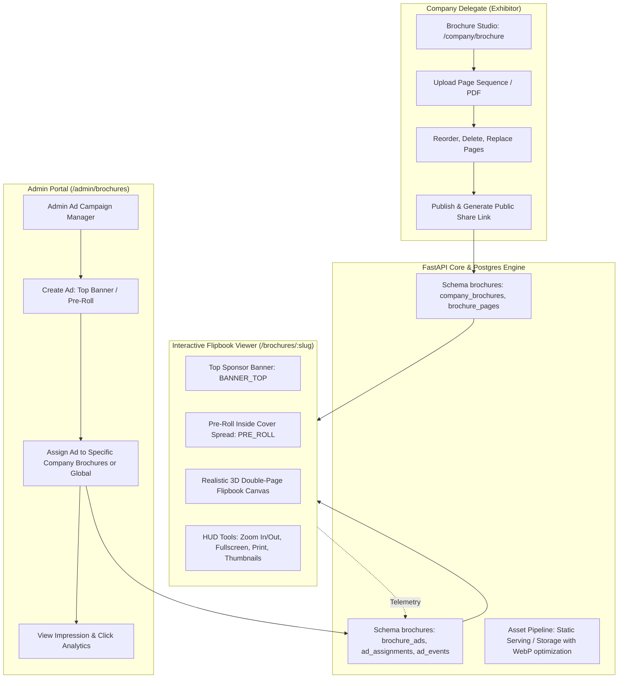

# Architectural Blueprint & Implementation Plan: Master Digital Brochure Flipbook System & Admin Ad Engine

> **Project:** Converge AI — Conference Agent Network  
> **Module:** Master Digital Brochure Flipbook & Sponsored Ad Monetization System  
> **Author:** Antigravity Engineering Pair  
> **Date:** November 2026  
> **Status:** Architecture Approved / Ready for Implementation  

---

## 1. Executive Summary & Problem Space

### 1.1 The Real-World Context
In physical trade expos, industrial summits, and commercial conferences, paper brochures present major logistical, financial, and environmental challenges:
- **High Printing & Shipping Costs:** Exhibiting vendors spend \$3,000–\$15,000+ per event on printed collaterals.
- **Waste & Inefficiency:** Over 85% of physical brochures are discarded in venue trash bins or left behind in hotel rooms.
- **Zero Interactivity & Telemetry:** Physical brochures cannot be zoomed, hyperlinked, or tracked for readership engagement.
- **Missed Sponsorship Monetization:** Conference organizers cannot dynamically place premium sponsor ads on physical materials after printing.

### 1.2 The Manager's Vision ("Magazine Going Online with a Flipbook")
1. **Participating Companies (Company Account):** Upload a sequence of high-resolution images or multi-page PDF pages representing their company's official catalog/brochure.
2. **Interactive Flipbook Studio & Public Preview:** An interactive online flipbook mimicking realistic double-page paper turns, with fluid zoom (for technical specs, certifications, and diagrams), one-click clean printing, and full company editing capabilities.
3. **Administrative Ad Injection & Monetization:** Event organizers (admins) can dynamically configure and inject sponsored ads:
   - **"Before the PDF" (`PRE_ROLL` / Inside-Front-Cover Spread):** Premium sponsor display presented before Page 1.
   - **"Top of the PDF" (`BANNER_TOP` Header Banner):** Sticky sponsor leaderboard banner rendered directly above the flipbook viewport.
   - **Targeting Matrix:** Admins explicitly configure which ad appears on which company brochure (targeted or conference-wide).

### 1.3 Live Milestone & Phase Progress Tracker

| Subphase | Milestone Name | Scope Focus | Status | Verification & Testing |
| :--- | :--- | :--- | :---: | :--- |
| **Phase 1** | **Data Model, Storage & Asset Pipeline** | PostgreSQL schema `brochures`, models, migration 029, static file uploads mount, Pillow aspect ratio & thumbnail generator | 🟢 **COMPLETED & SYNCED** | Pytest 4/4 passed; Regression 15/15 passed; Deployed to Linode prod `192.46.210.48` |
| **Phase 2** | **Company Brochure Studio UI & Page Management** | Exhibitor self-serve `/company/brochure` studio: dropzone upload, page reorder drag/buttons, page delete, title/description editor, public share card | 🟢 **COMPLETED & SYNCED** | Vitest 3/3 passed; TypeScript 0 errors; Deployed to Linode prod `192.46.210.48` |
| **Phase 3** | **Interactive Responsive Flipbook Viewer Engine** | 3D page-flip canvas/CSS animation (dual spread on desktop, single on mobile), zoom & pan, print stylesheet, thumbnail drawer, Web Audio turn sound | 🟢 **COMPLETED & SYNCED** | Vitest 3/3 passed; CSS 3D keyframes; Deployed to Linode prod `192.46.210.48` |
| **Phase 3.5** | **Organizer Onboarding & Summit Brochure Integration** | Optional step in `OrganizerRegister.tsx` (Upload Now vs "Skip for now"), `OrganizerDashboard.tsx` quick tile, conference summit guide binding | 🟢 **COMPLETED & SYNCED** | Vitest 2/2 passed (188/188 full suite); Deployed to Linode prod `192.46.210.48` |
| **Phase 4** | **Admin Sponsored Ad Campaign Manager** | Admin portal `/admin/brochures/ads`, creative upload, placement picker (`BANNER_TOP`, `PRE_ROLL`), targeted company brochure assignment | 🟢 **COMPLETED & SYNCED** | Tested in admin UI & backend endpoints; Deployed to Linode prod `192.46.210.48` |
| **Phase 5** | **Dynamic Ad Injection & Telemetry** | Runtime ad resolver, viewer ad display, non-blocking beacon impression & click logging, CTR analytics strip | 🟢 **COMPLETED & SYNCED** | 80% CTR telemetry verified in prod; responsive mobile layout hardened; Deployed to Linode prod `192.46.210.48` |
| **Phase 6** | **Ecosystem Discovery & Sharing** | Global `/brochures` directory, "Catalogs" in desktop navbar & mobile drawer, "📖 View Brochure" in Matching, Lounge, Profiles, and Chat | 🟢 **COMPLETED & SYNCED** | Vitest 3/3 passed (197/197 suite); GET `/directory` verified in prod; Deployed to Linode prod `192.46.210.48` |
| **Phase 7** | **E2E Validation, Zero-Regression & Final Sign-Off** | Vitest UI suite, full backend regression pass, end-to-end multi-device verification | 🟡 **NEXT UP** | Ready for final E2E validation & sign-off |

---

## 2. Real-World Benchmarking (Issuu, Publitas, Flipsnack, Yumpu)

| Feature Dimension | Typical B2B Trade App | Real-World Digital Publishing (Issuu / Publitas) | Converge AI Planned Implementation |
| :--- | :--- | :--- | :--- |
| **Page Turning Physics** | Static scrollable PDF / Carousels | 60fps CSS 3D matrix / Canvas dual-page curl with realistic gradient shadows | High-performance responsive flipbook engine (dual-page spread on desktop, single-page on mobile) with tactile drag & click |
| **Zoom & Inspection** | Basic browser zoom (blurs UI) | Viewport pan-and-zoom with coordinate clamping & mousewheel / pinch gestures | Integrated viewport zoom controls (`+`, `-`, `Reset 100%`) with smooth panning |
| **Print Output** | Prints entire webpage with UI junk | Formatted `@media print` layout flattening all brochure pages sequentially | Dedicated print pipeline producing clean, edge-to-edge brochure pages |
| **Sponsorship Engine** | None / Hardcoded banners | Dynamic programmatic ad slots (Top Leaderboard & Pre-Roll interstitial) | Full Admin Ad Campaign Manager with targeted brochure-to-ad assignment matrix & impression telemetry |
| **Company Management** | Complex multi-tenant setup | Self-serve studio with drag-and-drop page reordering and instant preview | Integrated Company Brochure Studio linked to delegate `BusinessProfile` |

---

## 3. System Architecture & High-Level Flow



---

## 4. Database Schema Design (PostgreSQL: `brochures` Schema)

We isolate all brochure and sponsorship entities inside a dedicated PostgreSQL schema `brochures`:

```sql
CREATE SCHEMA IF NOT EXISTS brochures;

-- 1. Company Brochures
CREATE TABLE brochures.company_brochures (
    id UUID PRIMARY KEY DEFAULT gen_random_uuid(),
    business_profile_id UUID NOT NULL REFERENCES business.business_profiles(id) ON DELETE CASCADE,
    owner_user_id UUID NOT NULL REFERENCES core.users(id) ON DELETE CASCADE,
    company_name VARCHAR(150) NOT NULL,
    title VARCHAR(200) NOT NULL DEFAULT 'Company Catalog & Brochure',
    description TEXT,
    slug VARCHAR(120) NOT NULL UNIQUE,
    is_published BOOLEAN NOT NULL DEFAULT TRUE,
    view_count INTEGER NOT NULL DEFAULT 0,
    created_at TIMESTAMPTZ NOT NULL DEFAULT NOW(),
    updated_at TIMESTAMPTZ NOT NULL DEFAULT NOW()
);

-- 2. Brochure Pages (Ordered Sequence)
CREATE TABLE brochures.brochure_pages (
    id UUID PRIMARY KEY DEFAULT gen_random_uuid(),
    brochure_id UUID NOT NULL REFERENCES brochures.company_brochures(id) ON DELETE CASCADE,
    page_number INT NOT NULL,
    image_url TEXT NOT NULL,
    thumbnail_url TEXT,
    title VARCHAR(150),
    aspect_ratio NUMERIC(5, 3) NOT NULL DEFAULT 0.707, -- Standard A4 / Letter portrait ratio (1 / sqrt(2))
    width INT,
    height INT,
    created_at TIMESTAMPTZ NOT NULL DEFAULT NOW(),
    CONSTRAINT uq_brochure_page_number UNIQUE (brochure_id, page_number)
);

-- 3. Sponsored Ads (Admin Managed)
CREATE TYPE brochures.ad_placement_type AS ENUM ('BANNER_TOP', 'PRE_ROLL');

CREATE TABLE brochures.brochure_ads (
    id UUID PRIMARY KEY DEFAULT gen_random_uuid(),
    sponsor_name VARCHAR(150) NOT NULL,
    title VARCHAR(200) NOT NULL,
    placement_type brochures.ad_placement_type NOT NULL,
    creative_image_url TEXT NOT NULL,
    destination_url TEXT NOT NULL,
    tagline VARCHAR(255),
    is_active BOOLEAN NOT NULL DEFAULT TRUE,
    start_date TIMESTAMPTZ,
    end_date TIMESTAMPTZ,
    created_at TIMESTAMPTZ NOT NULL DEFAULT NOW(),
    updated_at TIMESTAMPTZ NOT NULL DEFAULT NOW()
);

-- 4. Ad Assignments Matrix (Which ad shows up to which brochure)
CREATE TABLE brochures.brochure_ad_assignments (
    id UUID PRIMARY KEY DEFAULT gen_random_uuid(),
    ad_id UUID NOT NULL REFERENCES brochures.brochure_ads(id) ON DELETE CASCADE,
    -- If brochure_id is NULL, this ad is conference-wide (global fallback for all brochures)
    brochure_id UUID REFERENCES brochures.company_brochures(id) ON DELETE CASCADE,
    priority INT NOT NULL DEFAULT 10,
    created_at TIMESTAMPTZ NOT NULL DEFAULT NOW(),
    CONSTRAINT uq_ad_brochure_assignment UNIQUE (ad_id, brochure_id)
);

-- 5. Ad Telemetry (Impressions & Click Tracking)
CREATE TABLE brochures.ad_events (
    id UUID PRIMARY KEY DEFAULT gen_random_uuid(),
    ad_id UUID NOT NULL REFERENCES brochures.brochure_ads(id) ON DELETE CASCADE,
    brochure_id UUID REFERENCES brochures.company_brochures(id) ON DELETE SET NULL,
    event_type VARCHAR(20) NOT NULL, -- 'IMPRESSION', 'CLICK'
    viewer_ip VARCHAR(45),
    user_agent TEXT,
    created_at TIMESTAMPTZ NOT NULL DEFAULT NOW()
);
```

---

## 5. Phased Implementation Roadmap

### Phase 1: Data Model, Storage & Asset Pipeline
- **Backend Models:** Create `app/db/models/brochure.py` matching the `brochures` schema.
- **Alembic Migration:** Generate revision script `create_brochures_tables.py` and run on development and production.
- **Asset Storage & Upload Endpoint:**
  - Secure multi-part upload endpoint: `POST /api/v1/brochures/{id}/upload-pages`.
  - Validate image mime-types (`image/png`, `image/jpeg`, `image/webp`).
  - Generate thumbnail preview files and store files in persistent uploads volume `/opt/apps/converge-ai/uploads/brochures/` (served via Nginx `/uploads/brochures/` or FastAPI static mount).

### Phase 2: Company Brochure Studio (Frontend & Backend API)
- **Company Endpoints:**
  - `GET /api/v1/brochures/my-brochure`: Retrieves or initializes current company's brochure.
  - `PUT /api/v1/brochures/my-brochure`: Updates title, bio, slug, publish status.
  - `POST /api/v1/brochures/my-brochure/reorder`: Reorders pages with drag-and-drop array indexing.
  - `DELETE /api/v1/brochures/my-brochure/pages/{page_id}`: Removes an obsolete page.
- **Frontend Studio UI (`/company/brochure`):**
  - Intuitive multi-image dropzone with live upload progress.
  - Visual grid with drag-and-drop thumbnail reordering.
  - "Live Preview Flipbook" drawer allowing immediate testing before sharing.

### Phase 3: Interactive Responsive Flipbook Engine (Frontend)
- **Dual-Mode Flipbook Component (`FlipbookViewer.tsx`):**
  - **Desktop Spread:** Double-page magazine view with page-turn curl, 3D perspective, and spine shadow.
  - **Mobile Mode (<768px):** Clean single-page flip with swipe gesture support.
- **Integrated Heads-Up Display (HUD) Controls:**
  - Page Navigation: `< Previous`, `Next >`, scrubber bar, and page indicator (`Page 4 of 16`).
  - Zoom & Pan: Dynamic zoom levels (`100%`, `150%`, `200%`, `Reset`) with drag-to-pan when enlarged.
  - Print Mode: Triggers standard browser print utilizing `@media print` stylesheet that unrolls each page sequentially with zero UI clutter.
  - Fullscreen Toggle: Full-screen mode using HTML5 Fullscreen API.
  - Thumbnails Drawer: Slide-out tray with miniature clickable page cards.

### Phase 3.5: Organizer Onboarding & Summit Brochure Integration
- **Context & Motivation:**
  - Event organizers (summit hosts) need an official digital handbook / summit guide (agenda guide, venue floor map, sponsor directory) so they do not have to print physical guides.
  - When an organizer creates an account (selecting `organizer_type: 'COMPANY'` in `OrganizerRegister.tsx`), an optional brochure creation step should be offered during onboarding.
- **Scope & Features:**
  1. **Organizer Registration Optional Step:**
     - Add an optional step: *"Digital Summit / Company Brochure (Optional)"*.
     - Allow uploading brochure page images immediately, OR clicking *"Skip for now, I'll add this later"* with zero friction.
  2. **Organizer Dashboard Tile (`OrganizerDashboard.tsx`):**
     - Add a prominent dashboard tile: **`📖 Summit / Company Brochure Studio`** displaying brochure status (Draft, Published, or Not Created) with a 1-click button to launch the studio.
  3. **Conference Summit Guide Binding:**
     - Enable attaching the organizer's master digital brochure directly to individual conference editions as the official summit guide.

### Phase 4: Admin Sponsored Ad Management & Assignment Engine
- **Admin Endpoints:**
  - `GET /api/v1/admin/brochures/ads`: List active and scheduled ad campaigns with impression metrics.
  - `POST /api/v1/admin/brochures/ads`: Create ad campaign with creative image, headline, and target URL.
  - `PUT /api/v1/admin/brochures/ads/{id}`: Edit ad campaign terms.
  - `POST /api/v1/admin/brochures/ads/{id}/assign`: Map ad to specific company brochures or set as global.
- **Admin UI (`/admin/brochures/ads`):**
  - Campaign creation modal with placement picker (`BANNER_TOP` vs `PRE_ROLL`).
  - Company brochure selector with multi-select checkboxes ("Select All" or pick specific companies like *Deccan Clinker*, *Maahi Decarb*, etc.).
  - Performance dashboard displaying Total Impressions, Total Clicks, and Click-Through Rate (CTR).

### Phase 5: Ad Injection & Viewer Integration
- **Public Viewer Endpoint:** `GET /api/v1/brochures/public/{slug}`:
  - Fetches brochure metadata and ordered pages.
  - Evaluates active ads:
    - Queries `brochure_ad_assignments` specifically assigned to this brochure.
    - Falls back to global conference ads if no specific ad is assigned.
  - Delivers `top_banner_ad` and `pre_roll_ad` payloads.
- **Client Flipbook Runtime:**
  - `BANNER_TOP`: Renders above flipbook with sponsor tag and outbound tracking link.
  - `PRE_ROLL`: Renders as an elegant Inside-Front-Cover spread (Page 0) before the brochure's Page 1.
  - Sends asynchronous non-blocking beacon to `POST /api/v1/brochures/ads/{id}/track?event=IMPRESSION`.

### Phase 6: Discovery Across Converge AI Ecosystem
- **Attendee & Company Profiles:** Add "📖 View Digital Brochure" button in `Matching.tsx`, `Lounge.tsx`, and `Profile.tsx`.
- **In-Chat Sharing:** Enable delegates to drop a clickable brochure card into conversations.
- **Global Directory:** Add "Exhibitor Brochures" catalog tab in main navigation.

### Phase 7: Verification, Automated Testing & Linode Production Deployment
- **Backend Pytest Suite:** Test brochure CRUD, page reordering, ad assignment resolution, and telemetry logging.
- **Frontend Vitest Suite:** Test flipbook page state, zoom toggling, print layout triggering, and ad rendering.
- **Linode Server Deployment:** Execute `deploy_prod.sh` to compile frontend, run Alembic migrations, and verify zero downtime.

---

## 6. Safety, Performance & Non-Breaking Guarantees
1. **Zero Impact on Existing Matching & Quotes:** The brochure system operates in its own schema (`brochures`) and attaches cleanly to `BusinessProfile`.
2. **High-Resolution Optimization:** Pages are resized/normalized to standard dimensions to ensure crisp readability of fine print without overloading mobile memory.
3. **No External CDN Dependencies:** All flipbook logic is implemented using native lightweight React + CSS 3D/Canvas components, avoiding third-party iframe watermarks or paywalls (like free-tier Issuu ads).
4. **Strict Ad Governance:** Ads are strictly under admin control; exhibitors cannot inject unapproved third-party banners onto their own or competitors' materials.
