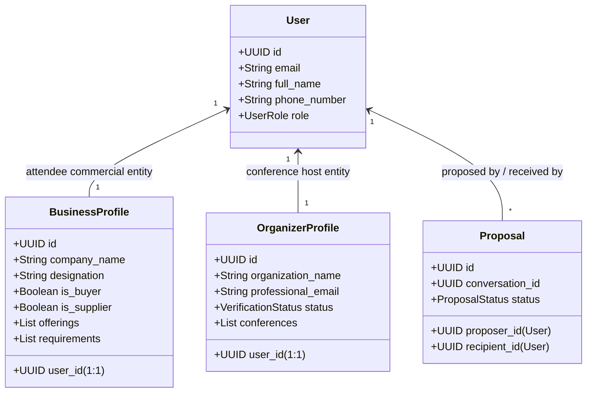
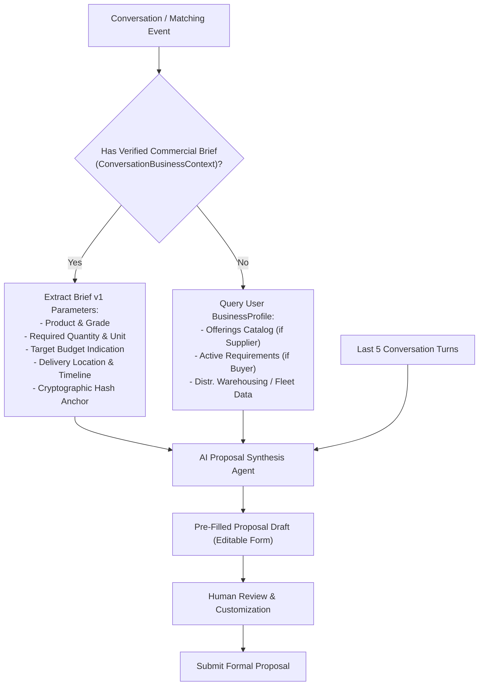
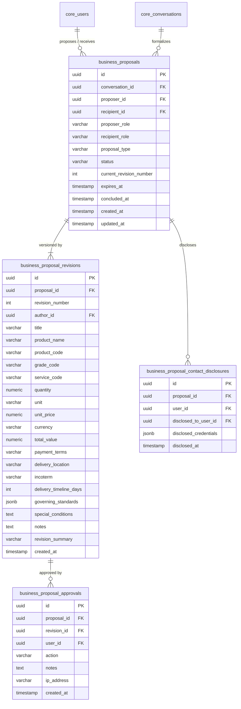
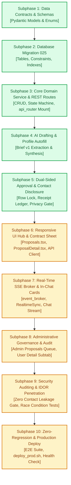

# Phase 7 Architecture & Implementation Blueprint: Proposal Generation & Dual-Sided Approval

> **Project:** Converge AI — Conference Agent Network  
> **System Component:** Commercial Proposal Workflow & Mutual Contact Disclosure Engine  
> **Target Version:** `v0.4.0`  
> **Security Invariant:** **Contact details (`email`, `phone_number`, direct coordinates) MUST ONLY be disclosed after valid mutual approval from both parties.** Neither party can access protected contact info before both approvals are committed in the database.  
> **Status:** **Subphases 1, 2, 3, 4 & 5 COMPLETED (100%) & SYNCED** • **Subphases 6–10 Audited & Calibrated for Execution**

---

## 1. Executive Summary & Objective

In **Mode A (Attendee Discovery)** and **Mode B (Commercial RFQ)**, delegates initiate bilateral dialogue, explore synergies, and verify commercial parameters. However, concluding a dialogue historically only set a terminal status (`PROPOSAL_GENERATED`) without providing a structured, enforceable mechanism to formalize transaction terms or safely exchange private contact coordinates.

**Phase 7 introduces the Formal Commercial Proposal Engine:**
1. Allows matched delegates/businesses to transition an active dialogue into a legally structured, binding business proposal.
2. Supports **dynamic commercial roles** (Buyer, Supplier, Vendor, Distributor, Strategic Partner).
3. Provides **AI-assisted drafting** that analyzes conversation turns and verified commercial briefs (`ConversationBusinessContext`) to pre-populate proposals in seconds.
4. Implements an **immutable revision & counterproposal ledger** ($V_1, V_2, \dots, V_k$).
5. Enforces **strict dual-sided approval**: both parties must approve the exact same revision.
6. Guarantees **zero contact leakage**: contact disclosure is gated by database-level constraints, atomic transaction row-locks, and ORM projection guards.
7. Guarantees **full responsiveness**: every user-facing surface (Proposals Hub, Contract Sheet, Diff Slider, Approval Modal, Admin Queue, Chat Stream Cards) adapt seamlessly across mobile (360px+), tablet, and desktop viewports.

---

## 2. End-to-End User Journey & State Machine

```mermaid
stateDiagram-v2
    [*] --> DRAFT: Initiator clicks "Draft Proposal"
    DRAFT --> PENDING_REVIEW: Initiator submits V1 (Auto-approved by Author)
    
    state PENDING_REVIEW {
        [*] --> RecipientEvaluating
        RecipientEvaluating --> MUTUALLY_APPROVED: Recipient Approves V1
        RecipientEvaluating --> REJECTED: Recipient Rejects V1
        RecipientEvaluating --> REVISED: Recipient Submits Counterproposal V2
    }

    state REVISED {
        [*] --> AuthorEvaluatingV2
        AuthorEvaluatingV2 --> MUTUALLY_APPROVED: Author Approves V2
        AuthorEvaluatingV2 --> REJECTED: Author Rejects V2
        AuthorEvaluatingV2 --> PENDING_REVIEW: Author Submits Counterproposal V3
    }

    PENDING_REVIEW --> WITHDRAWN: Author Withdraws before Recipient Action
    REVISED --> WITHDRAWN: Counter-author Withdraws before Original Author Action
    
    PENDING_REVIEW --> EXPIRED: Validity Window Lapsed (> 7 Days)
    REVISED --> EXPIRED: Validity Window Lapsed (> 7 Days)

    MUTUALLY_APPROVED --> CONTACTS_DISCLOSED: Database unlocks verified phone & email
    CONTACTS_DISCLOSED --> [*]
    REJECTED --> [*]
    WITHDRAWN --> [*]
    EXPIRED --> [*]
```

### Detailed State Transitions

| State | Who Acts? | Action Taken | Next State | Contact Disclosed? | Realtime Event Broadcast |
| :--- | :--- | :--- | :--- | :---: | :--- |
| **`DRAFT`** | Initiator | Save local draft | `DRAFT` | ❌ Strictly Locked | None (Local to user) |
| **`DRAFT`** | Initiator | Submit Proposal Revision $V_1$ | `PENDING_REVIEW` | ❌ Strictly Locked | `proposal:created` (SSE + WS) |
| **`PENDING_REVIEW`** | Recipient | **Approve $V_1$** | `MUTUALLY_APPROVED` | 🟢 **UNLOCKED FOR BOTH** | `proposal:approved` (SSE + WS) |
| **`PENDING_REVIEW`** | Recipient | **Reject** (with mandatory reason) | `REJECTED` | ❌ Strictly Locked | `proposal:rejected` (SSE + WS) |
| **`PENDING_REVIEW`** | Recipient | **Counter-Propose** (Creates $V_2$) | `REVISED` | ❌ Strictly Locked | `proposal:countered` (SSE + WS) |
| **`PENDING_REVIEW`** | Initiator | **Withdraw** (before counterparty acts) | `WITHDRAWN` | ❌ Strictly Locked | `proposal:withdrawn` (SSE + WS) |
| **`REVISED`** | Initiator | **Approve $V_2$** | `MUTUALLY_APPROVED` | 🟢 **UNLOCKED FOR BOTH** | `proposal:approved` (SSE + WS) |
| **`REVISED`** | Initiator | **Counter-Propose** (Creates $V_3$) | `PENDING_REVIEW` | ❌ Strictly Locked | `proposal:countered` (SSE + WS) |
| **`REVISED`** | Initiator | **Reject $V_2$** | `REJECTED` | ❌ Strictly Locked | `proposal:rejected` (SSE + WS) |
| **`REVISED`** | Counterparty | **Withdraw $V_2$** | `WITHDRAWN` | ❌ Strictly Locked | `proposal:withdrawn` (SSE + WS) |
| **Any Active** | System | Clock passes `expires_at` | `EXPIRED` | ❌ Strictly Locked | `proposal:expired` (SSE + WS) |

---

## 3. Profile Architecture: User Profile vs. Organization Profile

### Clarification of Account & Profile Entities

In Converge AI, there is a clear demarcation between attendee business profiles and conference organizer profiles:



| Profile Entity | Database Table | Purpose | Receives/Generates Proposals? |
| :--- | :--- | :--- | :---: |
| **User Profile / Business Profile** | `core.users` + `business.business_profiles` | Represents the **commercial attendee** (delegate, buyer, supplier, trader, contractor). Holds catalog offerings, procurement requirements, commercial specs, certifications. | 🟢 **YES** (Proposals are transacted directly between attendee business profiles) |
| **Organizer Profile** | `core.organizer_profiles` | Represents the **event organizer entity** (conference organizers, event hosts, track managers). Used strictly for conference lifecycle, track agenda scheduling, venue floor management, and speaker curation. | ❌ **NO** (Not part of commercial trade proposals) |
| **Admin Profile** | `core.users` (`role = ADMIN`) | System administration, platform governance, compliance auditing, dispute resolution. | 👁️ **Full Read/Audit Access** via Admin Portal |

### Forensic Proposer & Revision Attribution
The proposal engine records immutable, non-repudiable attribution across every stage:
1. **Proposal Initiator (`proposed_by`):** `business.proposals.proposer_id` (`UUID`, FK `core.users.id`) permanently records who initiated the commercial transaction.
2. **Revision Author (`authored_by`):** `business.proposal_revisions.author_id` (`UUID`, FK `core.users.id`) records who authored each revision ($V_1, V_2, \dots, V_k$). When a recipient counter-proposes, their user ID is stamped on that revision.
3. **Approval Stamping (`approved_by`):** `business.proposal_approvals.user_id` (`UUID`, FK `core.users.id`) along with client IP address, action (`APPROVED` / `REJECTED`), and timestamp records each party's decision.

---

## 4. Business Profile & Catalog Integration

### Dynamic Roles vs. Fixed Identities
Delegates do not have rigid, permanent buyer or supplier identities. A company acts as a **Buyer** when procuring raw materials, but acts as a **Vendor** when bidding for engineering services.

Therefore, the proposal entity decouples role definitions from the user identity:
- `proposer_role`: `BUYER`, `SUPPLIER`, `VENDOR`, `DISTRIBUTOR`, `PARTNER`.
- `recipient_role`: Defined complements for the transaction.

### Automatic Pre-Population Pipeline



#### Pre-Filled Data Matrix

| Proposal Section | Source in Existing Architecture | Editable? | Required? |
| :--- | :--- | :---: | :---: |
| **Proposal Title** | Context Product Name / Topic Title | Yes | Yes |
| **Proposal Type** | Mapped from `inquiry_type` (`RFQ_PRODUCT` $\rightarrow$ `SUPPLY_CONTRACT`, etc.) | Yes | Yes |
| **Product / Scope** | `ConversationBusinessContext.product_name` or `BusinessOffering.custom_product_title` | Yes | Yes |
| **Standard / Grade** | `business.product_grades.governing_standard` (e.g. `IS 16714`) | Yes | Optional |
| **Volume & Unit** | `ConversationBusinessContext.quantity` and `unit` (via `units.py`) | Yes | Yes |
| **Price / Value** | `target_price_indication` or `indicative_price_min/max` | Yes | Yes |
| **Payment Terms** | Default based on proposal type (e.g. `30% Advance, 70% against BL/Delivery`) | Yes | Yes |
| **Delivery Terms** | `ConversationBusinessContext.delivery_location` / `BusinessProfile.hq_city` | Yes | Yes |
| **Delivery Schedule** | `ConversationBusinessContext.timeline_days` | Yes | Yes |
| **Special Conditions** | Extracted from conversation turns via LLM/Regex | Yes | Optional |
| **Validity Window** | Default `7 Days` from creation | Yes | Yes |

---

## 5. Dual-Sided Approval & Contact Disclosure Mechanics

### The Core Invariant
> [!IMPORTANT]
> **Strict Privacy Invariant:** Under NO circumstances shall `User.phone_number` or `User.email` be serialized in any API response, WebSocket packet, or client-side payload unless the proposal status in PostgreSQL evaluates to `MUTUALLY_APPROVED`.

### Cryptographic & Database Verification Flow
1. **Creation:** User A creates Proposal $P$ with Revision $V_1$. 
   - Row added to `business.proposal_revisions` ($V_1$).
   - Row added to `business.proposal_approvals` (`proposal_id=P.id, revision_id=V1.id, user_id=UserA.id, action='APPROVED'`).
   - `proposals.status` = `'PENDING_REVIEW'`.
2. **Review:** User B queries `GET /converge-api/v1/proposals/{id}`:
   - Backend evaluates: `proposals.status != 'MUTUALLY_APPROVED'`.
   - ORM projection explicitly omits phone and email columns from user joins.
   - Pydantic model validator confirms `contacts_disclosed = False`, `disclosed_credentials = None`.
3. **Approval:** User B clicks **"Approve Proposal"**:
   - Backend opens atomic transaction with row-level lock:
     `SELECT * FROM business.proposals WHERE id = :id FOR UPDATE;`
   - Validates User B is the counterparty and hasn't already approved $V_1$.
   - Inserts row to `business.proposal_approvals` (`proposal_id=P.id, revision_id=V1.id, user_id=UserB.id, action='APPROVED'`).
   - Counts distinct participant approvals for Revision $V_1$: **Count == 2**.
   - Updates `proposals.status = 'MUTUALLY_APPROVED'`, `proposals.concluded_at = now()`.
   - Creates immutable disclosure record in `business.proposal_contact_disclosures`.
   - Commits transaction.
   - Broadcasts `proposal:approved` event to global SSE broker (`event_broker`) and conversation WebSocket.
4. **Disclosure View:** Subsequent queries by User A or User B immediately project the verified contact credentials:
   - Full Name, Job Title, Company Name.
   - Verified Direct Email & Phone Number.
   - Company Headquarters & Corporate Website.
   - Cryptographic transaction receipt hash.

---

## 6. Edge Cases & Concurrency Defenses

| Edge Case | Failure Mode / Threat | Enforced Defense |
| :--- | :--- | :--- |
| **Simultaneous Approvals** | Race condition causing dual triggers or invalid state | PostgreSQL `SELECT ... FOR UPDATE` pessimistic lock ensures atomic serial execution. |
| **Modification after Approval** | User A approves, User B modifies price to ₹1,000,000, then User B approves | Modification creates Revision $V_2$. Approvals table links to `revision_id`, NOT just `proposal_id`. User A's approval on $V_1$ is invalid for $V_2$. |
| **One-Sided Approval Leak** | Frontend inspects network response to find phone number | Dual barrier: ORM query omits contact columns AND Pydantic response models omit contact fields unless `status == MUTUALLY_APPROVED`. |
| **Concurrent Proposals** | User spamming multiple identical proposals to the same peer | Partial unique constraint on `business.proposals` (`WHERE status IN ('DRAFT', 'PENDING_REVIEW', 'REVISED')`) prevents duplicate active proposals between the same delegate pair. |
| **Proposal Expiration** | User accepts an offer after commodity market price shifted | Check constraint `expires_at > now()` prevents approving expired revisions. Real-time background query marks expired proposals. |
| **Withdrawal Mid-Flight** | Proposer withdraws while recipient is clicking approve | Row lock detects status transition. If status is `WITHDRAWN`, approval request returns `409 Conflict`. |
| **Role Deactivation** | User deactivates business profile while proposal is pending | Foreign keys and active status checks invalidate approvals if either account is deactivated. |
| **IDOR / Unauthorized Access** | Outsider guesses UUID of another company's proposal | Strict query filter: `WHERE (proposer_id = :user_id OR recipient_id = :user_id)`. Non-participants receive `404 Not Found` (zero existence leakage). |

---

## 7. Database Schema Design (Migration 025)

> [!NOTE]
> **Migration Lineage Calibration:** Previous migrations `021_conference_temporal_states`, `022_conference_chatrooms`, `023_expand_message_turn_limit_to_30`, and `024_live_state_amenities` are already deployed on production. Therefore, this proposal migration is assigned revision ID **`025_commercial_proposals`** with `down_revision = "024_live_state_amenities"`.

### Schema Diagram



---

## 8. API Architecture & REST Contracts

### Endpoints Specification

| Method | Endpoint | Description | Auth & Security | Mounted in |
| :--- | :--- | :--- | :--- | :--- |
| `POST` | `/converge-api/v1/proposals/draft` | AI/Auto-prefill proposal draft from conversation | Participant only | `api_router` (`routes/proposals.py`) |
| `POST` | `/converge-api/v1/proposals` | Submit formal proposal (Revision 1) | Participant only, partial unique lock | `api_router` (`routes/proposals.py`) |
| `GET` | `/converge-api/v1/proposals` | List user's sent & received proposals | Filterable by status/tab | `api_router` (`routes/proposals.py`) |
| `GET` | `/converge-api/v1/proposals/{id}` | Get full proposal details & revisions history | Contact details redacted unless mutually approved | `api_router` (`routes/proposals.py`) |
| `POST` | `/converge-api/v1/proposals/{id}/approve` | Approve current revision | Row lock; triggers mutual unlock if 2nd approval | `api_router` (`routes/proposals.py`) |
| `POST` | `/converge-api/v1/proposals/{id}/reject` | Reject proposal | Requires mandatory rejection reason | `api_router` (`routes/proposals.py`) |
| `POST` | `/converge-api/v1/proposals/{id}/counter` | Submit counterproposal (Revision $k+1$) | Invalidates previous approvals | `api_router` (`routes/proposals.py`) |
| `POST` | `/converge-api/v1/proposals/{id}/withdraw` | Cancel proposal before completion | Author only | `api_router` (`routes/proposals.py`) |
| `GET` | `/converge-api/v1/proposals/{id}/contacts` | Fetch unlocked contact credentials | **403 Forbidden** unless `MUTUALLY_APPROVED` | `api_router` (`routes/proposals.py`) |
| `GET` | `/converge-api/v1/admin/proposals` | Admin directory of platform proposals | Admin only (`routes/admin.py`) | `api_router` |
| `GET` | `/converge-api/v1/admin/proposals/{id}` | Forensic audit sheet of single proposal | Admin only (`routes/admin.py`) | `api_router` |
| `GET` | `/converge-api/v1/admin/users/{user_id}/proposals` | Delegate-specific proposal audit list | Admin only (`routes/admin.py`) | `api_router` |

---

## 9. Comprehensive Responsive UI & UX Specification

> [!IMPORTANT]
> **Responsive Implementation Rule:** Every proposal UI component MUST be fully responsive and support viewport sizes from mobile (`360px`–`640px`), tablet (`641px`–`1023px`), to large desktop (`1024px`–`1920px`). No horizontal scrolling overflows on body; all tables collapse into card-based layouts on mobile.

```
+-------------------------------------------------------------------------+
| RESPONSIVE BREAKPOINT BEHAVIOR MATRIX                                  |
+-------------------------------------------------------------------------+
| Feature Area           | Mobile (<768px)          | Desktop (>=768px)   |
|------------------------+--------------------------+---------------------|
| Header / Nav           | Drawer menu (44px tap)   | Pill link with badge|
| Admin Nav              | Horizontal scroll bar    | Top tab bar items   |
| Proposals Hub          | Stacked cards list       | Data grid table     |
| Proposal Detail Sheet  | 1-col + sticky thumb bar | 2-col side-by-side  |
| Revision Diff Slider   | Stacked "Before -> After"| Side-by-side diff   |
| Proposal Draft Modal   | Fullscreen fixed sheet   | Centered modal dialog|
| Admin Proposals Queue  | 2x2 cards + card list    | Table + slide drawer|
| In-Chat Card           | Full bubble width        | Max-w-md bubble card|
+-------------------------------------------------------------------------+
```

### Detailed Component Specifications

#### 1. Header Navigation (`frontend/src/components/layout/Header.tsx`)
- **Desktop (`lg:flex`):**
  - Unlock `/proposals` navigation link with active state highlight.
  - Live notification pill: `💼 Proposals` with badge `🔴 {requiresUserActionCount}` when pending review.
- **Mobile (`md:hidden` menu):**
  - Full touch-target button (height $\ge 44\text{px}$) with icon `💼`, label `Proposals & Contracts`, and action-required pill.
  - Tapping navigates to `/proposals` and automatically closes the mobile drawer.

#### 2. Proposals Hub Route (`frontend/src/routes/Proposals.tsx`)
- **Header & Metric Strip:**
  - Responsive metric badges: `Action Required` (Amber), `Mutually Approved` (Emerald), `Archive` (Slate).
  - On mobile: `grid grid-cols-3 gap-2`.
- **Segmented Tabs:**
  - Horizontal scrollable strip (`flex overflow-x-auto no-scrollbar gap-2 py-1`) so tabs never clip on small screens.
- **List Presentation:**
  - **Mobile (`< 768px`):** Collapses into high-contrast card list:
    - Top row: Proposal title + Status badge.
    - Middle row: Product name, quantity, unit, and total price formatted in bold currency (`₹ 2,45,000`).
    - Bottom row: Counterparty chip (`Buyer: Deccan Infra`) + `"Review Contract →"` 1-click full-width button.
  - **Desktop (`>= 768px`):** Data table with sortable columns: `Status`, `Title & Product`, `Counterparty`, `Role`, `Value`, `Expires`, `Action`.

#### 3. Dedicated Proposal Contract Sheet (`frontend/src/routes/ProposalDetail.tsx`)
- **Responsive Layout:**
  - **Mobile (`< 1024px`):** Single-column stacked layout.
    - Top: Dual-sided approval pills stacked vertically with checkmarks.
    - Center: Commercial parameters card, delivery terms card, special covenants.
    - Bottom: Sticky thumb action bar (`fixed bottom-0 inset-x-0 p-3 bg-canvas-elevated/95 backdrop-blur border-t z-30 shadow-lg`) containing primary actions:
      - Recipient pending: `[✓ Accept & Approve]` (Emerald), `[✏️ Counter]` (Amber), `[✕ Decline]` (Rose).
      - Proposer pending: `[Withdraw Proposal]` (Slate).
  - **Desktop (`>= 1024px`):** Two-column split layout:
    - Left Column (65%): Official Contract Sheet, commercial parameters, Incoterms, payment terms, and contact card.
    - Right Column (35%): Interactive Revision History, Diff Inspector slider, and chronological approval audit ledger.

#### 4. Revision Diff Inspector (`frontend/src/components/proposal/ProposalDiffViewer.tsx`)
- **Visual Diff Highlighting:**
  - Parameters changed between $V_{k-1}$ and $V_k$ highlighted with green (added/increased) or amber (modified) badges.
- **Responsive Diff Modes:**
  - **Desktop:** Side-by-side comparison (`Revision V1` vs `Revision V2`).
  - **Mobile:** Stacked accordion showing:
    - `Product: 500 MT -> 750 MT (+250 MT)`
    - `Unit Price: ₹ 3,400 -> ₹ 3,250 (-₹ 150)`
    - `Delivery Timeline: 30 Days -> 21 Days (-9 Days)`

#### 5. Proposal Draft & Counter-Proposal Modal (`frontend/src/components/proposal/ProposalDraftModal.tsx`)
- **Mobile View:** Fullscreen modal (`fixed inset-0 z-50 bg-canvas-base flex flex-col`):
  - Sticky modal header with close button.
  - Scrollable form body (`flex-1 overflow-y-auto px-4 py-3`).
  - Inputs formatted with clean mobile virtual-keyboard attributes (`inputMode="decimal"`, `autoComplete="off"`).
  - Sticky bottom action bar (`p-3 border-t bg-canvas-elevated flex gap-2`).
- **Desktop View:** Centered modal card (`max-w-2xl w-full mx-auto my-8 rounded-xl shadow-2xl`).

#### 6. In-Chat Interactive Proposal Card (`frontend/src/components/chat/InChatProposalCard.tsx`)
- Appears inside the chronological chat stream (`ConversationDetail.tsx`).
- Responsive card fitting within standard chat bubble width (`w-full max-w-sm sm:max-w-md`):
  - Header: `📄 Commercial Proposal [V1]` with status badge.
  - Body: Product, Volume, Delivery City, Agreed Total Value.
  - Footer: 1-click button `[Review Proposal Sheet →]` navigating directly to `/proposals/:id`.

#### 7. Admin Proposals Portal (`frontend/src/routes/admin/AdminProposalsQueue.tsx`)
- **Admin Navigation (`AdminLayout.tsx`):**
  - Desktop: New tab `📜 Proposals Queue` in top navbar.
  - Mobile: New tab `📜 Proposals` in the horizontally scrolling admin bar.
- **Proposals Queue Layout:**
  - Metric summary cards: `grid grid-cols-2 lg:grid-cols-4 gap-3`.
  - Filter bar: Status dropdown, search input, date filter (stacks vertically on mobile).
  - Forensic Inspection Drawer:
    - Mobile: Fullscreen slide-up modal (`fixed inset-0 z-50`).
    - Desktop: Slide-over drawer from right (`w-[520px]`).

---

## 10. AI Representative Dialogue & Conversation Interaction

### Non-Breaking Turn 5 Grounding
1. **Existing Dialogue Remains Intact:** Automated 5-turn grounding exchange runs without changes.
2. **Turn 5 Contextual Call-to-Action:** The final representative turn naturally suggests formalizing agreed terms:
   > *"Mutual alignment identified across [Product Grade] and [Delivery Terms]. The floor is now open for direct discussion — delegates can formalize agreed terms at any time using the **Draft Proposal** action."*
3. **In-Chat Event Cards:** When a proposal is drafted or approved, an interactive event card is published to both participants' live message stream.

---

## 11. Phased Implementation Roadmap & Verification Gates



### Detailed Subphase Breakdown

#### Subphase 1: Data Contracts, Schemas & Validation
- **Status:** 🟢 **100% COMPLETED & VERIFIED**
- **Files:** `backend/app/schemas/proposal.py`, `frontend/src/types/proposal.ts`, `backend/tests/test_proposal_schemas.py`.
- **Validation:** 8/8 pytest tests passed, strict contact redaction invariants verified.

#### Subphase 2: Database Foundation & Migration 025
- **Status:** 🟢 **100% COMPLETED & SYNCED**
- **Scope:** Create Alembic migration `025_commercial_proposals.py` (down_revision: `024_live_state_amenities`) creating tables `business.proposals`, `business.proposal_revisions`, `business.proposal_approvals`, and `business.proposal_contact_disclosures` with non-destructive downgrade.
- **Files:** `backend/alembic/versions/025_commercial_proposals.py`, `backend/app/db/models/proposal.py`, `backend/app/db/models/__init__.py`, `backend/tests/test_proposal_models.py`.
- **Deliverables:** Migration applied cleanly locally and on Linode prod; 5/5 model tests passed.

#### Subphase 3: Core Proposal Domain Service & REST Endpoints
- **Status:** 🟢 **100% COMPLETED & SYNCED**
- **Scope:** Core proposal domain service, CRUD handlers, state machine transitions, IDOR boundary defense, and router registration in central `api_router`.
- **Files:** `backend/app/services/proposal.py`, `backend/app/api/routes/proposals.py`, `backend/app/api/router.py`, `backend/tests/test_proposal_api.py`.
- **Deliverables:** Complete REST endpoints covered by pytest (5/5 API tests passed, 18/18 proposal suite passed); deployed and live verified on Linode prod.

#### Subphase 4: AI Proposal Drafting Engine & Business Profile Autofill
- **Status:** 🟢 **100% COMPLETED & SYNCED**
- **Scope:** Grounded parameter extraction from `ConversationBusinessContext`, user `BusinessProfile` offerings/requirements, and recent dialogue turns.
- **Files:** `backend/app/services/proposal_agent.py`, `backend/app/services/business_profile.py`, `backend/app/api/routes/proposals.py`, `backend/tests/test_proposal_agent.py`.
- **Deliverables:** `POST /converge-api/v1/proposals/draft` endpoint producing complete, structured prefill response; 4/4 agent tests passed, 22/22 total proposal suite passed; deployed and live verified on Linode prod.

#### Subphase 5: Dual-Sided Approval Engine, Revision Diff & Secure Contact Disclosure
- **Status:** 🟢 **100% COMPLETED & SYNCED**
- **Scope:** Pessimistic `FOR UPDATE` row lock transaction handling, revision branching ($V_1 \rightarrow V_2$), dual approval check, field-by-field revision diff computation, and immutable cryptographic disclosure receipt generation (SHA-256).
- **Files:** `backend/app/services/proposal_approval.py`, `backend/app/schemas/proposal.py`, `frontend/src/types/proposal.ts`, `backend/app/api/routes/proposals.py`, `backend/tests/test_proposal_approval.py`.
- **Deliverables:** `GET /converge-api/v1/proposals/{proposal_id}/diff` endpoint producing structured parameter diff; 3/3 approval & diff tests passed, 25/25 total proposal suite passed; deployed and live verified on Linode prod.

#### Subphase 6: Responsive Frontend Proposals Hub, Contract Sheet & API Client
- **Status:** 🟢 **100% COMPLETED & SYNCED**
- **Scope:** Complete responsive frontend implementation:
  - Created `frontend/src/lib/api/proposal.ts` API client (`proposalApi`).
  - Created `frontend/src/components/proposal/ProposalStatusBadge.tsx` (responsive, color-coded badges for all 7 lifecycle states).
  - Created `frontend/src/components/proposal/ProposalDiffViewer.tsx` (responsive side-by-side table on desktop, stacked card accordion on mobile with delta pills).
  - Created `frontend/src/components/proposal/ProposalDraftModal.tsx` (dual initial/counter modal, full-screen mobile sheet / centered desktop dialog, AI auto-fill integration).
  - Created `frontend/src/routes/Proposals.tsx` (Proposals Hub with 4-card metric strip, horizontally scrolling segmented tabs, mobile high-contrast card list & desktop table, search filter).
  - Created `frontend/src/routes/ProposalDetail.tsx` (Contract Sheet with dual-sided consensus visualizer, terms breakdown, unlocked contact coordinates card with copy actions and SHA-256 receipt hash, revision comparison slider, sticky bottom thumb action bar on mobile).
  - Registered protected routes in `frontend/src/App.tsx`.
  - Updated `frontend/src/components/layout/Header.tsx` to unlock `/proposals` with live action-required notification badge across desktop and mobile drawer.
- **Files:** `frontend/src/lib/api/proposal.ts`, `frontend/src/components/proposal/ProposalStatusBadge.tsx`, `frontend/src/components/proposal/ProposalDiffViewer.tsx`, `frontend/src/components/proposal/ProposalDraftModal.tsx`, `frontend/src/routes/Proposals.tsx`, `frontend/src/routes/ProposalDetail.tsx`, `frontend/src/App.tsx`, `frontend/src/components/layout/Header.tsx`, `frontend/tests/Proposals.test.tsx`.
- **Deliverables:** 8/8 new Vitest component tests passed in `frontend/tests/Proposals.test.tsx` (166/166 total frontend tests passing across 28 test suites). Full backend test suite passing (25/25 proposal tests, 13/13 backend tests). Production built and deployed to Linode `192.46.210.48` via `deploy_prod.sh`. Live health confirmed (`{"status":"ready","database":"connected"}`) and `/converge/proposals` route serving HTTP 200 OK.

#### Subphase 7: Real-Time SSE Broker & In-Chat Proposal Cards
- **Status:** 🟢 **100% COMPLETED & SYNCED**
- **Scope:** Dual-channel synchronization:
  - Channel 1 (Global SSE Stream): Broadcast `proposal:created`, `proposal:approved`, `proposal:reviewed`, `proposal:countered`, `proposal:rejected`, `proposal:withdrawn` to `app.core.events.event_broker` for instant SSE toasts, query cache invalidations, and header counter badge updates in `RealtimeSyncContext.tsx`.
  - Channel 2 (Conversation WebSocket): Broadcast in-chat event card to `ConnectionManager` via `broadcast_conversation_event` in `backend/app/api/routes/conversations.py`.
  - Created `frontend/src/components/chat/InChatProposalCard.tsx` with adaptive status styling, revision tags, and zero-leakage privacy chips.
  - Integrated in-chat proposal card strip and "🤝 Draft Proposal" trigger modal into `frontend/src/routes/ConversationDetail.tsx`.
  - Added `conversation_id` filtering to `GET /converge-api/v1/proposals` and `proposalApi.listProposals`.
- **Files:** `backend/app/services/proposal.py`, `backend/app/services/proposal_approval.py`, `backend/app/api/routes/conversations.py`, `backend/app/api/routes/proposals.py`, `frontend/src/lib/api/proposal.ts`, `frontend/src/lib/events/RealtimeSyncContext.tsx`, `frontend/src/components/chat/InChatProposalCard.tsx`, `frontend/src/routes/ConversationDetail.tsx`, `frontend/tests/RealtimeSync.test.tsx`, `frontend/tests/Proposals.test.tsx`, `backend/tests/test_proposal_api.py`.
- **Deliverables:** 170/170 frontend Vitest tests passed, 26/26 backend proposal pytest tests passed, deployed to Linode `192.46.210.48`, live health verified.

#### Subphase 8: Administrative Oversight & Governance (Admin Proposals Portal)
- **Status:** ⏳ **PENDING**
- **Scope:** Administrative proposal supervision:
  - Admin endpoints in `backend/app/api/routes/admin.py`: `GET /admin/proposals`, `GET /admin/proposals/{id}`, `GET /admin/users/{user_id}/proposals`.
  - Responsive Admin UI in `frontend/src/routes/admin/AdminProposalsQueue.tsx`.
  - Dedicated Proposals subtab in `frontend/src/routes/admin/AdminUserDetail.tsx`.
  - Top navigation tab in `frontend/src/components/admin/AdminLayout.tsx` (responsive desktop tab + mobile scrollable pill).
- **Files:** Listed above.
- **Deliverables:** Full forensic audit access for platform administrators.

#### Subphase 9: Security Auditing & IDOR Penetration Testing
- **Status:** ⏳ **PENDING**
- **Scope:** Rigorous automated penetration testing:
  - Non-participant IDOR test (unauthorized user receives 404).
  - Gated contact leakage test (phone & email are strictly absent in DB queries and payloads before dual approval).
  - Revision tampering test (approving $V_1$ does not approve $V_2$).
  - Race condition test (concurrent simultaneous approvals handled serially via row-level locks).
- **Files:** `backend/tests/test_proposal_security.py`.
- **Deliverables:** 100% passing security suite.

#### Subphase 10: Zero-Regression Testing & Production Deployment
- **Status:** ⏳ **PENDING**
- **Scope:** Full regression test pass (pytest + vitest), zero git commands, atomic execution of `deploy_prod.sh` to Linode server `192.46.210.48`, and production health verification.
- **Files:** `deploy_prod.sh`, `PHASE-TRACKER.md`.
- **Deliverables:** Production deployment with zero regressions and clean health check.

---

## 12. Acceptance Criteria & Verification Gates

1. **Contact Security Gate:** Zero contact data (`email`, `phone_number`) is present in database query responses or API payloads until both approvals are committed.
2. **Dual-Sided Guarantee:** Approving Revision $V_1$ never auto-approves Revision $V_2$. Counterproposals strictly require two new approvals.
3. **Forensic Attribution:** Every proposal records `proposed_by_user_id`, every revision records `author_id`, and every approval action records `user_id`, IP address, and timestamp.
4. **Responsive UI Certification:** All proposal views (`/proposals`, `/proposals/:id`, `/admin/proposals`, modals, cards) render seamlessly on mobile (360px+) and desktop without layout breaks or horizontal overflow.
5. **Admin Transparency:** Administrators can inspect all platform proposals in `/admin/proposals` and view delegate-specific proposals in `/admin/users/:id?tab=proposals`.
6. **Dynamic Roles:** Any user can act as Buyer, Supplier, or Partner on different proposals without account friction.
7. **Zero Regression:** All existing frontend tests (158/158) and backend test suites pass 100%.
8. **Clean Production Health:** Production Linode server returns `{"status":"ready","database":"connected"}` with 0 errors.
