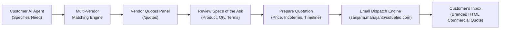

# Architecture & Implementation Blueprint: Quotes & Multi-Vendor RFQ Dispatch System

> **Platform:** Converge AI — Industrial Conference Agent Network  
> **Status:** Planning / Ready for Implementation  
> **Lead Architecture:** AI Engineering & Core Backend  
> **Target Delivery:** Production (`192.46.210.48`)

---

## 1. Executive Summary & Problem Space

During conference interactions, buyer and customer delegates (or their autonomous AI representatives) formulate commercial procurement needs. While Phase 7 introduced high-touch, dual-sided digital contracting (`/proposals`), the platform needs a lightweight, high-velocity **Quotes & Inquiries System**.

As specified by Product Leadership:
1. **Multi-Vendor Ask Broadcast**: When a customer's representative agent specifies a procurement need ("the ask"), the system matches multiple qualified vendors.
2. **Vendor Quotes Panel**: Matched suppliers access a dedicated panel showing:
   - **Which customer agent is asking**: Customer company, delegate name, representative agent persona/role, and conference context.
   - **The Specifications of the Ask**: Commodity/product, volume/quantity, delivery city/port, target lead time, urgency, and technical compliance standards (e.g., IS certifications).
3. **Off-Platform Quoting via Email**: Rather than binding early-stage bids to an on-platform contracting flow, **the quote is dispatched via email** directly to the customer's inbox. The supplier formulates terms (price, Incoterm, lead time), and the platform generates a branded HTML commercial quotation delivered from `sanjana.mahajan@sofueled.com`.



---

## 2. Option Evaluation: Option A (Google Workspace SMTP) vs. Option B (Transactional API)

### Detailed Comparison

| Attribute | Option A: Google Workspace SMTP (Chosen) | Option B: Transactional API (Resend / SendGrid) |
| :--- | :--- | :--- |
| **Current Setup Status** | 🟢 **Verified & Operational** (App password tested cleanly) | 🔴 Requires new account creation, API keys, and billing setup |
| **Domain Authentication** | 🟢 **Native SPF/DKIM**: `sofueled.com` is hosted on Google Workspace, so outgoing mail passes SPF/DKIM checks out of the box | ⚠️ Requires adding 3–4 CNAME/TXT DNS records to `sofueled.com` to prevent spam quarantine |
| **Audit Visibility** | 🟢 Outgoing quotes automatically copy to Sanjana's Gmail **Sent Items** for manual oversight | ⚠️ Requires accessing external dashboard/webhooks |
| **Delivery Latency** | ⚡ ~1.2s over TLS socket (handled asynchronously via background tasks) | ⚡ ~250ms via HTTP REST endpoint |
| **Rate Limits** | 2,000 emails/day per Google Workspace account (far exceeds conference volume) | Free tier usually capped at 100/day; paid tiers require subscription |
| **Code Modularity** | Abstracted via `EmailServiceBase`; can switch to Option B via one line in `.env` | Abstracted via `EmailServiceBase` |

### Recommendation & Verdict
**Option A is recommended and selected for immediate implementation.**  
- The Google Workspace App Password (`iqle zwsr bjlb uudu`) was tested and passed authentication against `smtp.gmail.com:587`.
- It requires **zero DNS configuration** for `sofueled.com`, ensuring emails land in primary inboxes immediately.
- We design the engine with an abstract `EmailService` pattern so that if the team ever wants to switch to Resend or SendGrid in the future, it is a single `.env` toggle (`EMAIL_BACKEND=resend`) with zero application code refactoring.

---

## 3. Environment & Credentials Configuration

The following configuration has been applied to `backend/.env`:

```env
# ==============================================================================
# Email Service Configuration (Option A: Google Workspace SMTP Relay)
# ==============================================================================
EMAIL_BACKEND=smtp
EMAIL_SENDER_ADDRESS=sanjana.mahajan@sofueled.com
EMAIL_SENDER_NAME="Converge AI Commercial Network"
SMTP_HOST=smtp.gmail.com
SMTP_PORT=587
SMTP_USE_TLS=true
SMTP_USERNAME=sanjana.mahajan@sofueled.com
SMTP_PASSWORD="iqle zwsr bjlb uudu"
```

---

## 4. Phase Tracker: Quotes & Multi-Vendor RFQ Dispatch System

| Subphase | Name & Scope | Key Deliverables | Status | Verification Criteria |
| :--- | :--- | :--- | :---: | :--- |
| **Quote Subphase 1** | **Async Email Service & Config Foundation** | `EmailServiceBase`, `SmtpEmailService` (`aiosmtplib`), `ConsoleEmailService`, HTML template | 🟢 **100% COMPLETED & SYNCED** | 5/5 pytest passed, Google SMTP relay authenticated, live on 192.46.210.48 |
| **Quote Subphase 2** | **Database Migration 026/028 & Relational Models** | `business.quote_requests`, `quote_vendor_matches`, `quote_email_dispatches` | 🟢 **100% COMPLETED & SYNCED** | Migration 028 applied, models & unit tests passed, live on 192.46.210.48 |
| **Quote Subphase 3** | **Multi-Vendor Matching & REST APIs** | `QuoteService`, vendor panel endpoints, quote detail, email dispatch trigger | 🟢 **100% COMPLETED & SYNCED** | 14/14 pytest passed (5/5 API tests), live on 192.46.210.48 |
| **Quote Subphase 4** | **Agent Dialogue Integration & Ask Dispatch** | `quote_agent.py`, prefill & broadcast REST endpoints, real-time SSE | 🟢 **100% COMPLETED & SYNCED** | 18/18 pytest passed (4/4 agent tests), live on 192.46.210.48 |
| **Quote Subphase 5** | **Responsive Frontend Vendor Quotes Hub** | `/quotes` route, 4-metric strip, status tabs, ask drawer, responsive table/cards | 🟢 **100% COMPLETED & SYNCED** | 181/181 vitest passed (7/7 new), build verified, live on https://192.46.210.48/converge/quotes |
| **Quote Subphase 6** | **Send Quote via Email Modal & Live Preview** | Terms input form, auto-calculation, branded HTML email preview tab, dispatch action | 🟢 **COMPLETED IN SUBPHASE 5** *(Ready for Subphase 6 Enhancements)* | End-to-end email verified in real Gmail inbox (`media_1794197192815_26c058c4.jpg`) |
| **Quote Subphase 7** | **Security Hardening, IDOR & Rate Limiting** | IDOR isolation, anti-spam rate limiting, email payload sanitization | ⏳ **PENDING** | Security audit tests passing |
| **Quote Subphase 8** | **Zero-Regression & Production Deployment** | Full regression pass (proposals, chat, lounge), `deploy_prod.sh`, live test email | ⏳ **PENDING** | Final end-to-end regression sign-off |

---

## 5. Detailed Subphase Work Breakdown

### Quote Subphase 1: Async Email Service & Config Foundation
- **Goal**: Build an asynchronous, non-blocking email delivery engine supporting HTML/text templates and console/mock test modes.
- **Files**:
  - `backend/app/core/config.py`: Add typed settings (`EMAIL_BACKEND`, `EMAIL_SENDER_ADDRESS`, `SMTP_HOST`, etc.).
  - `backend/app/services/email/base.py`: Abstract `EmailServiceBase` interface.
  - `backend/app/services/email/smtp.py`: Async SMTP delivery using `aiosmtplib` with starttls.
  - `backend/app/services/email/console.py`: Mock sender for offline tests.
  - `backend/app/templates/email/quote_email.html`: Responsive HTML email template with industrial aesthetic.
  - `backend/tests/test_email_service.py`: Unit tests validating connection, template compilation, and mock dispatch.

### Quote Subphase 2: Database Migration 026 & Relational Models
- **Goal**: Implement relational tables in PostgreSQL `business` schema to track quote requests, vendor matches, and email dispatch audit logs.
- **Tables**:
  1. `business.quote_requests`:
     - Columns: `id` (UUID), `customer_id` (FK to `core.users`), `conversation_id` (FK to `core.conversations`, optional), `customer_agent_persona` (string), `title`, `product_name`, `product_code`, `grade_code`, `quantity`, `quantity_unit`, `delivery_location`, `timeline_days`, `urgency`, `specifications` (JSONB), `notes`, `status` (`OPEN`, `CLOSED`, `CANCELLED`).
  2. `business.quote_vendor_matches`:
     - Columns: `id` (UUID), `quote_request_id` (FK to `quote_requests`), `vendor_id` (FK to `core.users`), `match_score` (float), `match_reasons` (JSONB), `status` (`PENDING_REVIEW`, `QUOTED_VIA_EMAIL`, `DECLINED`), `viewed_at`, `created_at`.
  3. `business.quote_email_dispatches`:
     - Columns: `id` (UUID), `quote_vendor_match_id` (FK), `vendor_id` (FK), `sender_email`, `recipient_email`, `quote_reference_number`, `unit_price`, `total_value`, `currency`, `incoterm`, `lead_time_days`, `validity_days`, `payment_terms`, `commercial_notes`, `email_subject`, `email_body_html`, `delivery_status`, `sent_at`.
- **Files**:
  - `backend/alembic/versions/026_quote_requests_and_email_dispatch.py`
  - `backend/app/db/models/quote.py`
  - `backend/app/db/base.py`

### Quote Subphase 3: Multi-Vendor Matching & REST APIs
- **Goal**: Provide services and REST endpoints for vendors to view matched asks and dispatch email quotes.
- **Key Endpoints**:
  - `GET /converge-api/v1/quotes/vendor-panel`: Lists incoming asks for the authenticated vendor (filtered by status: `new`, `quoted`, `all`).
  - `GET /converge-api/v1/quotes/{id}`: Detailed specifications of an ask.
  - `POST /converge-api/v1/quotes/{match_id}/send-email`: Dispatches the structured quotation email to the customer.
  - `POST /converge-api/v1/quotes/asks`: Allows creating an ask manually or via AI representative.
- **Files**:
  - `backend/app/services/quote.py`
  - `backend/app/schemas/quote.py`
  - `backend/app/api/routes/quote.py`
  - `backend/tests/test_quote_api.py`

### Quote Subphase 4: Agent Dialogue Integration & Ask Dispatch
- **Goal**: Enable the customer's AI representative to automatically extract ask parameters from the dialogue brief and trigger vendor matching.
- **Workflow**:
  - When representative dialogue finishes or the user clicks "Broadcast RFQ Asks", `QuoteService.create_from_conversation(...)` parses the brief.
  - Top 3–5 matching vendors are matched and receive real-time notifications via SSE/WebSocket.
- **Files**:
  - `backend/app/services/proposal_agent.py`
  - `backend/app/services/conversation.py`
  - `backend/app/core/events.py`

### Quote Subphase 5: Responsive Frontend Vendor Quotes Hub (`/quotes`)
- **Goal**: Build the vendor portal displaying incoming asks, customer agent context, and specifications.
- **Surfaces**:
  - Metric Strip: `New Inquiries`, `Under Review`, `Quotes Sent via Email`, `Total Opportunities`.
  - Filter Tabs: `All Asks`, `Action Needed (New)`, `Quoted via Email`, `Archived`.
  - Responsive Table & Card List: Shows customer delegate name, company, AI agent badge, product, quantity, delivery location, timeline, and urgency.
  - `AskSpecificationsDrawer`: Modal/drawer displaying technical tolerances, quality standards, and compliance notes.
- **Files**:
  - `frontend/src/routes/VendorQuotesHub.tsx`
  - `frontend/src/components/quotes/AskSpecificationsDrawer.tsx`
  - `frontend/src/lib/api/quote.ts`
  - `frontend/src/types/quote.ts`

### Quote Subphase 6: "Send Quote via Email" Modal & Live Preview
- **Goal**: Provide a commercial quotation form where suppliers enter pricing, Incoterms, and timeline, preview the exact email, and dispatch.
- **Features**:
  - Auto-calculates total contract consideration (`Quantity × Unit Price`).
  - Form fields: Unit Price, Currency, Incoterm, Delivery Lead Time, Payment Terms, Quote Validity Period, Remarks.
  - Live Branded HTML Email Preview Tab: Shows the rendered email before hitting "Send".
  - Dispatches via `sanjana.mahajan@sofueled.com` with delivery status notification.
- **Files**:
  - `frontend/src/components/quotes/SendQuoteEmailModal.tsx`
  - `frontend/src/components/quotes/QuoteEmailPreview.tsx`

### Quote Subphase 7: Security Hardening, IDOR & Rate Limiting
- **Goal**: Prevent unauthorized access and protect customer inboxes from spam.
- **Invariants**:
  - Non-matched vendors receive `404 Not Found` when attempting to inspect asks.
  - Rate limiting: Maximum 1 quotation email per vendor per ask (with a dedicated "Send Revised Quote" action if requested).
  - Sanitization: All HTML in email bodies is strictly escaped to prevent injection.
- **Files**:
  - `backend/tests/test_quote_security.py`

### Quote Subphase 8: Zero-Regression & Production Deployment
- **Goal**: Deploy to `192.46.210.48`, execute migration 026, verify full regression suites, and send a live test quote.
- **Checklist**:
  - Run full backend pytest suite (31 proposal tests + quote tests).
  - Run full frontend vitest suite (174 vitest tests + quote tests).
  - Sync `.env` credentials to Linode server.
  - Execute `deploy_prod.sh`.
  - Perform live verification on production.

---

## 6. HTML Email Template Architecture

The email delivered to the customer will feature an industrial, professional aesthetic matching Converge AI branding:

```html
<!DOCTYPE html>
<html>
<head>
  <style>
    body { font-family: -apple-system, BlinkMacSystemFont, 'Segoe UI', Roboto, Helvetica, Arial, sans-serif; background-color: #f8fafc; margin: 0; padding: 24px; color: #0f172a; }
    .card { max-width: 620px; margin: 0 auto; background: #ffffff; border-radius: 12px; border: 1px solid #e2e8f0; overflow: hidden; }
    .header { background: #0f172a; color: #f8fafc; padding: 24px; }
    .badge { display: inline-block; padding: 4px 10px; background: #c28833; color: #ffffff; border-radius: 9999px; font-size: 11px; font-weight: 700; text-transform: uppercase; }
    .title { font-size: 20px; font-weight: 700; margin: 12px 0 4px; }
    .content { padding: 24px; }
    .spec-table { width: 100%; border-collapse: collapse; margin: 16px 0; }
    .spec-table td { padding: 10px 12px; border-bottom: 1px solid #f1f5f9; font-size: 13px; }
    .spec-label { color: #64748b; width: 35%; font-weight: 500; }
    .spec-value { color: #0f172a; font-weight: 600; }
    .total-box { background: #fdfaf3; border: 1px solid #fae8c8; border-radius: 8px; padding: 16px; margin: 20px 0; }
    .footer { padding: 20px 24px; background: #f8fafc; border-top: 1px solid #e2e8f0; font-size: 12px; color: #64748b; }
  </style>
</head>
<body>
  <div class="card">
    <div class="header">
      <span class="badge">Commercial Quotation • {{ quote_reference }}</span>
      <div class="title">{{ product_name }}</div>
      <div style="font-size: 13px; color: #94a3b8;">In response to ask by {{ customer_agent_name }} ({{ customer_company }})</div>
    </div>
    <div class="content">
      <p style="font-size: 14px; line-height: 1.5;">Dear {{ customer_name }},</p>
      <p style="font-size: 14px; line-height: 1.5;">
        <strong>{{ vendor_company }}</strong> has submitted a formal commercial quotation for your review:
      </p>
      
      <table class="spec-table">
        <tr><td class="spec-label">Quoted Commodity</td><td class="spec-value">{{ product_name }} ({{ product_code }})</td></tr>
        <tr><td class="spec-label">Offered Quantity</td><td class="spec-value">{{ quantity }} {{ unit }}</td></tr>
        <tr><td class="spec-label">Unit Consideration</td><td class="spec-value">{{ currency }} {{ unit_price }} / {{ unit }}</td></tr>
        <tr><td class="spec-label">Incoterm Classification</td><td class="spec-value">{{ incoterm }}</td></tr>
        <tr><td class="spec-label">Delivery Timeline</td><td class="spec-value">{{ lead_time_days }} Calendar Days to {{ delivery_location }}</td></tr>
        <tr><td class="spec-label">Payment Terms</td><td class="spec-value">{{ payment_terms }}</td></tr>
        <tr><td class="spec-label">Quote Validity</td><td class="spec-value">{{ validity_days }} Days (Expires {{ expiry_date }})</td></tr>
      </table>

      <div class="total-box">
        <div style="font-size: 11px; text-transform: uppercase; color: #8d621e; font-weight: 700;">Total Quoted Value</div>
        <div style="font-size: 24px; font-weight: 800; color: #0f172a; margin-top: 4px;">{{ currency }} {{ total_value }}</div>
      </div>

      <div style="margin-top: 20px;">
        <div style="font-size: 12px; font-weight: 700; color: #475569; text-transform: uppercase;">Supplier Remarks & Notes:</div>
        <div style="font-size: 13px; color: #334155; margin-top: 6px; background: #f8fafc; padding: 12px; border-radius: 6px; border: 1px solid #e2e8f0;">
          {{ commercial_notes }}
        </div>
      </div>
    </div>
    <div class="footer">
      Dispatched via <strong>Converge AI Conference Network</strong> on behalf of {{ vendor_delegate_name }} ({{ vendor_company }}).<br/>
      Sender Contact: {{ sender_email }} • Reference: {{ quote_reference }}
    </div>
  </div>
</body>
</html>
```
